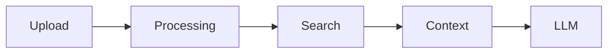
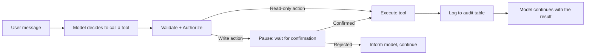

# Chat IA

A full-stack chat application built with Laravel 13, Vue 3, and Inertia.js. Supports multiple LLM models via OpenRouter, real-time streaming responses, a RAG (Retrieval-Augmented Generation) knowledge base, and an admin panel for usage management.

## Stack

- **Backend:** PHP 8.3, Laravel 13, Laravel Sanctum
- **Frontend:** Vue 3, Inertia.js, Tailwind CSS, Reka UI
- **Database:** MySQL 9.0+
- **Queue:** Laravel Jobs (document processing)
- **Embeddings:** Ollama (local embeddings with nomic-embed-text model)
- **PDF export:** barryvdh/laravel-dompdf
- **Document parsing:** smalot/pdfparser, phpoffice/phpword

## Features

### Chat
- Real-time streaming responses via Server-Sent Events (SSE)
- Multiple LLM model selection per message (via OpenRouter)
- Configurable temperature and max token parameters
- File attachment support (PDF, DOCX, TXT parsed server-side)
- Pinned conversations
- Conversation search
- Export conversations as Markdown or PDF
- Share conversations via public or restricted token links
- Message comments/annotations

### Knowledge Base (RAG)
- Create named knowledge collections
- Upload documents (PDF, DOCX, TXT) to a collection
- Documents are chunked and embedded asynchronously via queued jobs
- Cosine similarity search against stored embeddings at query time
- Source attribution shown below responses ("Fontes utilizadas")

### Saved Prompts
- Create, edit, and delete reusable prompt templates
- Accessible from the message input

### Admin Panel
- Per-user token and cost usage limits
- Reset individual user usage
- Audit log viewer with CSV export
- Usage limits dashboard

### Tools & Function Calling
- The assistant can call backend tools during a conversation to perform concrete actions, not just generate text
- 5 tools available: calculator, user lookup, usage query, note creation, and knowledge base search
- Write actions (creating a note) pause the response and require explicit user confirmation before running
- Every tool call is logged to an audit table (`tool_executions`) with status, parameters, result, duration, and errors
- Model-provided parameters are always validated server-side and never trusted directly (see "Tools" table below)
- The UI shows a live status indicator per tool call (waiting / running / done / error), expandable to see the technical result

## Architecture

### Knowledge base (RAG) flow



1. **Upload** — the user uploads a document to a `KnowledgeCollection` via `KnowledgeController@uploadDocument`; the file is parsed and stored as a `KnowledgeDocument`.
2. **Processing** — the `ProcessKnowledgeDocument` queued job splits the document into chunks and calls `EmbeddingService` (Ollama, `nomic-embed-text`) to generate an embedding vector for each chunk, stored as `KnowledgeSegment` rows.
3. **Search** — when a user asks a question with a collection selected, `RagService::search()` embeds the query and ranks the stored segments by cosine similarity.
4. **Context** — the top matching segments are injected as context into the conversation history before the message is sent to the model.
5. **LLM** — `MessageController` streams the model's response (via `OpenRouterService`) back to the user over Server-Sent Events, citing the sources used.

### Tools & Function Calling flow



Each tool implements a common `App\Contracts\Tool` interface (`name`, `description`, `parameters`, `requiresConfirmation`, `authorize`, `execute`) and is registered in `App\Services\ToolRegistry`. Parameters coming from the model are treated as untrusted input: every tool validates them server-side (via `Illuminate\Support\Facades\Validator`) before doing anything, and `authorize()` checks the acting user's permissions independently of what the model provided.

| Tool | Name (used by the model) | Requires confirmation | Key parameters |
|---|---|---|---|
| Calculator | `calculator` | No | `operation` (add / subtract / multiply / divide / percentage), `a`, `b` |
| User lookup | `search_users` | No — admin only | `name`, `email`, `status` (verificado / por_verificar) |
| Usage query | `query_usage` | No | `period` (today / 7_days / 30_days / this_month / all_time), `scope` (self / user / global), `user_email` |
| Create note | `create_note` | **Yes** | `title`, `content` |
| Knowledge base search | `search_knowledge` | No | `query`, `collection_ids`, `top_k` |

Every tool call — successful or not — is recorded in the `tool_executions` table with the acting user, the tool name, the parameters received, the result (or error message), the duration, and its status (`a_analisar` → `a_executar` → `concluido`/`erro`, or `a_aguardar_confirmacao`/`cancelado` for actions needing confirmation).

## Requirements

- PHP 8.3+
- Composer
- Node.js 18+
- MySQL 9.0+
- An [OpenRouter](https://openrouter.ai) API key
- [Ollama](https://ollama.ai)

## Installation

```bash
git clone <repo-url>
cd chat-ia

composer install
npm install
```

Install Ollama from https://ollama.ai, then pull the embedding model:

```bash
ollama pull nomic-embed-text
```

On macOS, start Ollama as a background service:

```bash
brew services start ollama
```

Copy and configure your environment file:

```bash
cp .env.example .env
php artisan key:generate
```

Configure your `.env`:

```env
OPENROUTER_API_KEY=your_key_here
OLLAMA_URL=http://localhost:11434
```

Run migrations and start the development server:

```bash
php artisan migrate
php artisan queue:work &
npm run dev
php artisan serve
```

## Testing

```bash
php artisan test
```

## Environment Variables

| Variable | Description |
|---|---|
| `OPENROUTER_API_KEY` | API key for OpenRouter model access |
| `OLLAMA_URL` | URL for local Ollama embedding service |
| `QUEUE_CONNECTION` | Set to `database` for persistent job queuing (default: `sync`) |

## Project Structure

```
app/
  Http/Controllers/     # API and page controllers
  Jobs/                 # Queued document processing jobs
  Models/               # Eloquent models
  Services/
    OpenRouterService   # Streaming LLM calls
    EmbeddingService    # Text embedding via Ollama (local)
    RagService          # Cosine similarity search
resources/js/
  Pages/                # Inertia page components
  Components/Chat/      # Chat UI components
  Components/Knowledge/ # Knowledge base UI components
tests/
  Feature/              # HTTP and integration tests
```
